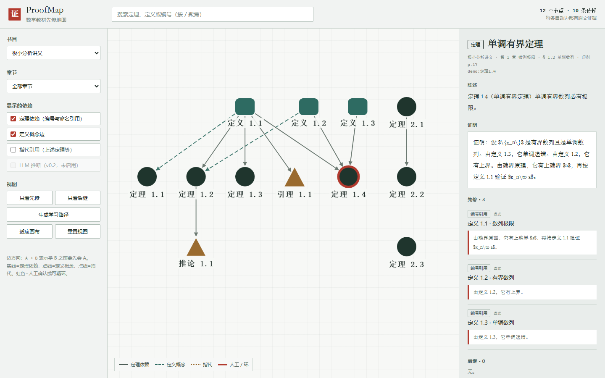

# ProofMap

把数学教材与笔记变成一张**每条边都能引用原文**的先修依赖图。

[在线 demo](https://nddcv1.github.io/proofmap/) · [设计文档](docs/superpowers/specs/2026-11-01-proofmap-design.md)



## 它做什么

- 从数学教材的 `chunks.jsonl` 中抽取定义、定理、引理、推论、命题。
- 把独立的证明 chunk 归属到它证明的定理或例题。
- 抽取四类依赖边：编号引用、命名引用（如 Rolle 定理）、指代引用（“上述定理”）、定义概念边。
- 每条自动边都保存证明原文中的 quote 和字符区间；没有证据就不生成边。
- 生成一个**单文件、离线可打开**的交互 HTML：按章过滤、只看先修/后继、生成学习路径、点开每条边看原文。
- 抽取错误通过 `corrections.yaml` 修正，不需要改代码。

方向约定：`A → B` 表示学 B 之前要先会 A。

## 为什么值得做

GitHub 上的定理依赖图大多绑定 Lean：形式化数学的依赖是现成的。面向非形式化的中文教材和笔记、要求每条边可追溯原文、并报告抽取误差的项目很少。ProofMap 处理的是“教材散文里的依赖”，难点和卖点都在这里。

## 快速开始

需要 Python 3.10+。推荐用 [uv](https://docs.astral.sh/uv/)：

```bash
uv sync --extra dev
uv run proofmap build --chunks examples/demo/chunks.jsonl --out build/demo --book demo
uv run proofmap render --build build/demo --out demo.html
```

打开 `demo.html` 即可离线浏览。也可以直接打开仓库里的 [docs/index.html](docs/index.html)（在线 demo 的同一份文件）。

用 pip 的话：

```bash
python -m venv .venv
# Windows: .venv\Scripts\activate
# macOS/Linux: source .venv/bin/activate
pip install -e ".[dev]"
proofmap build --chunks examples/demo/chunks.jsonl --out build/demo --book demo
proofmap render --build build/demo --out demo.html
```

## 配合 math-kb 使用

如果你已经有 math-kb 的教材切块 `chunks.jsonl`：

```bash
uv run proofmap build --chunks <path-to-chunks.jsonl> --out build/mathkb
uv run proofmap audit --build build/mathkb
uv run proofmap render --build build/mathkb --out build/mathkb/proofmap.html
```

例如本地 math-kb 的产物在 `D:/zzt/math-kb/data/chunks.jsonl`，把上面的占位路径替换掉即可。

`build/mathkb/` 里会有：

- `nodes.jsonl` / `attachments.jsonl` / `edges.jsonl` / `graph.json`
- `attachment_audit.md`：归属歧义、未归属、被 detach 的证明
- `edge_audit.md`：各类型边数量、未解析/歧义引用、孤立节点、环
- `node_audit.md`：重复编号、合并记录、解析警告

`build/` 已在 `.gitignore` 中。不要提交教材原文、私有笔记或原始 PDF。

## 输出界面

- 左右两侧分别是过滤器和节点详情；中间是按书/章过滤的依赖图。
- 实线=定理依赖，虚线=定义概念，点线=指代引用，粗红线=人工确认。
- 选中节点后可以：
  - 看陈述、归属证明、页码；
  - 看每条先修边的原文证据；
  - 只看先修 / 只看后继；
  - 生成上游拓扑排序的“学习路径”；
  - 搜索编号、标题或别名。
- 默认只显示当前书里依赖最密的章节，并隐藏无依赖节点；可以手动切换章节或勾选“显示孤立节点”。

## 当前状态（2026-11-01）

Demo（`examples/demo`，合成数据）：

- 12 个节点，11 条边，9 个证明全部归属。
- 8 个手标证明：attachment accuracy 1.000，edge precision 1.000，edge recall 1.000。
- 50 个自动化测试。

本地 math-kb 全量基线（5 本书，未提交数据）：

- 545 个节点，151 条边，0 个环。
- 475 个证明：386 已归属，55 歧义，34 未归属。
- 84 条未解析/歧义引用，全部写入 `edge_audit.md`。

这些数字是基线，不是“已完成”的声明。真实的 30 个证明黄金集还没标；当前只对 demo 报告指标。

## 抽取流程

```text
chunks.jsonl
   │  节点抽取（定义 / 定理族，稳定 ID，分页合并）
   ▼
nodes.jsonl ──► 证明归属（同节 + 邻近 + 打分 + 歧义清单）
   │
   ▼
边抽取（编号 → 命名 → 指代 → 定义术语）
   │
   ▼
corrections.yaml（别名 / 强制归属 / 加删边）
   │
   ▼
graph.json ──► 单文件 HTML
```

### 证明归属

在同一个 section 内向前最多 5 个 chunk 找最近的定理/例/习题：

- 同 section +0.45；距离 1–5 加 0.40–0.10；
- 证明里点名目标编号/标题 +0.30；
- 目标已有内联证明 −0.50；
- 最近的目标且分数 ≥0.55 直接归属；其余要求分差 ≥0.15，否则进歧义清单。

### 边类型

| type | 含义 | 置信度 |
|---|---|---|
| `numbered_ref` | `由定理 9.2.2` | explicit |
| `named_ref` | `由 Rolle 定理` | explicit |
| `anaphora_ref` | `由上述定理` | tentative |
| `definition_term` | 证明/陈述里出现定义术语 | inferred |
| `manual` | `corrections.yaml` 人工添加 | confirmed |

同一对节点只保留最强的一条证据边（manual > numbered > named > llm > anaphora > definition）。

## 数据契约

`nodes.jsonl` 一行一个节点，至少包含：

```json
{
  "id": "shuxia:定理9.2.2",
  "kind": "theorem",
  "subkind": "theorem",
  "label": "定理 9.2.2",
  "title": "……",
  "aliases": ["定理 9.2.2"],
  "book_id": "shuxia",
  "chapter": "第9章 数项级数",
  "section": "§9.2 上极限与下极限",
  "pdf_page": 31,
  "printed_page": 8,
  "statement": "……",
  "proof": "……",
  "source_chunks": ["shuxia-p0031-0123"]
}
```

`edges.jsonl` 一行一条边：

```json
{
  "from": "shuxia:定理7.1.2",
  "to": "shuxia:定理9.2.2",
  "type": "numbered_ref",
  "confidence": "explicit",
  "proof_chunk": "shuxia-p0313-1053",
  "evidence": {
    "quote": "由定理 7.1.2 可知……",
    "char_start": 123,
    "char_end": 156
  },
  "source": "rule"
}
```

## 纠错

`corrections.yaml` 支持：

```yaml
proof_attachments:
  force:
    - proof_chunk: shuxia-p0313-1053
      target: shuxia:定理9.2.2
      reason: 证明正文复述了该定理条件
  detach:
    - proof_chunk: shuxia-p0401-1402
      reason: 实为例题证明，误挂到定理

aliases:
  shufeng:定理5.2.3:
    - Rolle 定理
    - 罗尔定理

edges:
  add:
    - from: shuxia:定义9.2.1
      to: shuxia:定理9.2.2
      reason: 证明直接使用上极限定义
  remove:
    - from: shuxia:定理3.1.2
      to: shuxia:定理9.2.2
      reason: OCR 编号误匹配
```

传给 `build`：`--corrections corrections.yaml`。

## 评测

```bash
uv run proofmap eval --build build/demo --gold gold/demo_gold.yaml
```

输出：

```text
gold proofs: 8
attachment accuracy: 1.000
edge precision: 1.000
edge recall: 1.000
tp=11 fp=0 fn=0
```

黄金集格式见 `gold/README.md`。`gold/textbook_starter.yaml` 故意留空：30 个真实教材证明必须人工标注，不能用工具输出回填。

## CLI

```text
proofmap build   --chunks <path> --out <dir> [--book a,b] [--corrections yaml]
proofmap audit   --build <dir>
proofmap render  --build <dir> --out <html>
proofmap query   prereq <node-id> [--depth N|all] [--include-concepts]
proofmap query   dependents <node-id> [--depth N|all]
proofmap eval    --build <dir> --gold <yaml>
```

所有命令支持 `--json`。`query` 的输出是上游/下游节点的层级列表。

## 开发

```bash
uv sync --extra dev
uv run --extra dev pytest -q
```

测试覆盖：节点抽取与分页合并、证明归属、编号/命名/指代引用、定义概念边、纠错、证据 span、环检测、审计、评测、渲染、CLI 端到端。

## 已知限制

- v0.1 是纯规则；隐式依赖会漏，LLM 闭集补边在 v0.2。
- 只收显式 `kind=definition`；正文里的“称…为…”定义还没抽。
- 不做跨书依赖，例如数分下引用数分上的定理会进未解析清单。
- 本地全量基线里仍有 55 个歧义、34 个未归属证明；需要看 `attachment_audit.md` 或写 corrections。
- 公式以 LaTeX 源码显示，不做排版；终端和离线 HTML 都如此。
- 30 个真实教材证明的黄金集还没标，因此不对真实数据宣称 precision/recall。
- 笔记覆盖（Obsidian）在 v0.2，还没做。

## License

MIT。第三方前端库的许可证在 `proofmap/render/vendor/*.LICENSE`，说明见 [THIRD_PARTY_NOTICES.md](THIRD_PARTY_NOTICES.md)。
